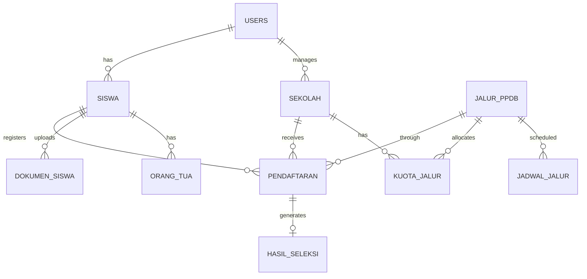
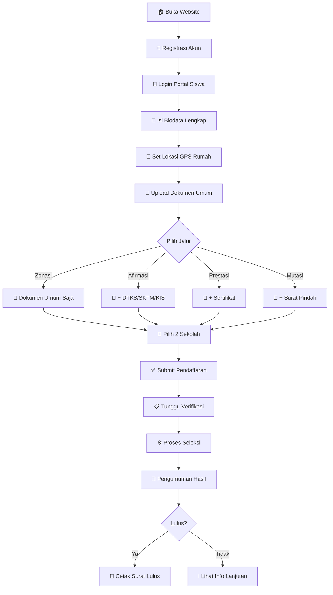
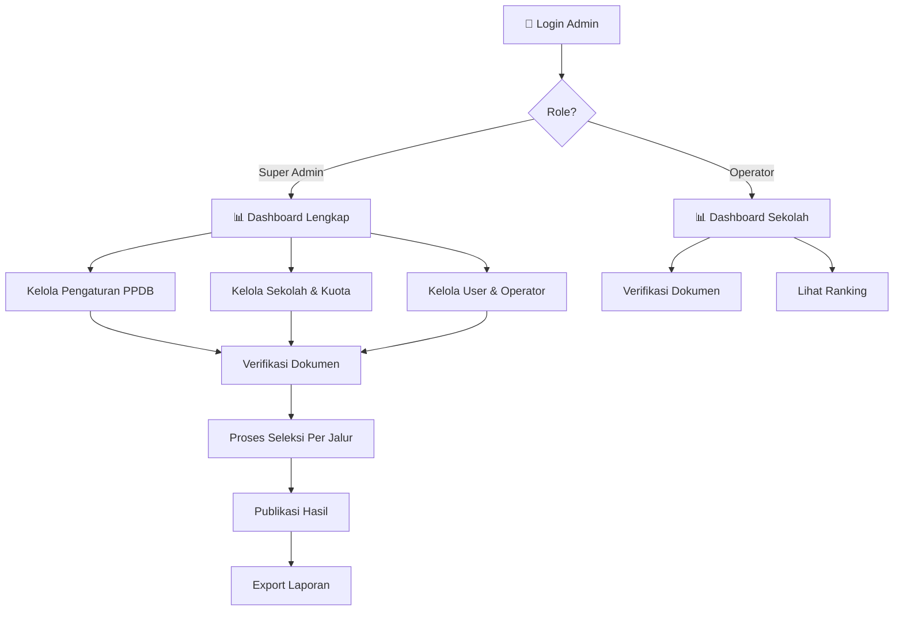

# 📊 Analisis Lengkap Sistem PPDB SMP Kota Padang

**Dokumen Teknis untuk Presentasi Klien**  
*Tanggal: 4 Januari 2026*

---

## 1. 🎯 Ringkasan Eksekutif

**PPDB SMP** adalah Sistem Penerimaan Peserta Didik Baru berbasis web yang dikembangkan untuk Dinas Pendidikan Kota Padang. Sistem ini mengelola seluruh proses pendaftaran siswa SMP secara online dan terintegrasi.

### Keunggulan Utama
| Aspek | Keterangan |
|-------|------------|
| **Jangkauan** | 20 SMP Negeri, 5 Kecamatan (data saat ini) |
| **Kapasitas** | Ribuan pendaftar serentak |
| **Aksesibilitas** | 100% online, 24/7 |
| **Transparansi** | Seleksi otomatis berbasis algoritma |
| **Keamanan** | CSRF, bcrypt, prepared statements |

---

## 2. 🏗️ Arsitektur Sistem

### 2.1 Technology Stack

```
┌─────────────────────────────────────────────────────────────┐
│                    FRONTEND LAYER                            │
│  ┌─────────────┐  ┌──────────────┐  ┌─────────────────────┐ │
│  │   HTML5     │  │  CSS3        │  │    JavaScript       │ │
│  │   Bootstrap │  │  Responsive  │  │    Leaflet.js       │ │
│  │   5.3       │  │  Design      │  │    Chart.js         │ │
│  └─────────────┘  └──────────────┘  └─────────────────────┘ │
└─────────────────────────────────────────────────────────────┘
                            │
                            ▼
┌─────────────────────────────────────────────────────────────┐
│                    BACKEND LAYER                             │
│  ┌─────────────────────────────────────────────────────────┐│
│  │                    PHP 7.4+                             ││
│  │  • MySQLi (Prepared Statements)                         ││
│  │  • Session Management                                   ││
│  │  • CSRF Protection                                      ││
│  │  • Password Hashing (bcrypt)                            ││
│  └─────────────────────────────────────────────────────────┘│
└─────────────────────────────────────────────────────────────┘
                            │
                            ▼
┌─────────────────────────────────────────────────────────────┐
│                    DATABASE LAYER                            │
│  ┌─────────────────────────────────────────────────────────┐│
│  │              MySQL 5.7+ / MariaDB 10.4+                 ││
│  │              Database: ppdb_smp                         ││
│  │              11 Tabel, InnoDB Engine, UTF8MB4           ││
│  └─────────────────────────────────────────────────────────┘│
└─────────────────────────────────────────────────────────────┘
```

### 2.2 Struktur Direktori

```
ppdb-smp/ (Total: ~500KB source code)
│
├── 📂 admin/           (16 files) - Admin Panel
│   ├── sekolah/       - CRUD Sekolah
│   ├── seleksi/       - Proses Seleksi & Ranking
│   ├── verifikasi/    - Verifikasi Dokumen
│   ├── users/         - Manajemen User
│   ├── laporan/       - Export Data
│   └── *.php          - Dashboard, Login, Pengaturan
│
├── 📂 siswa/           (13 files) - Portal Siswa
│   ├── biodata.php    - Form Biodata (41KB)
│   ├── pilih_sekolah.php - Pemilihan Sekolah (53KB)
│   ├── dokumen.php    - Upload Dokumen (28KB)
│   └── *.php          - Login, Hasil, Cetak
│
├── 📂 config/          - Konfigurasi
│   ├── database.php   - Koneksi DB & 30+ Helper Functions
│   ├── constants.php  - Konstanta Global
│   └── dokumen_config.php - Config Dokumen
│
├── 📂 assets/
│   ├── css/           - Stylesheets
│   ├── js/            - JavaScript (maps, charts)
│   └── data/          - GeoJSON Kecamatan
│
├── 📂 database/
│   └── schema.sql     - Schema Lengkap (273 baris)
│
├── 📂 includes/        - Components
│   ├── navbar.php, footer.php
│   ├── sidebar_admin.php, sidebar_siswa.php
│   └── csrf.php       - CSRF Protection
│
├── 📂 uploads/         - File Siswa
│   └── dokumen/       - KK, Ijazah, Rapor, Foto
│
└── 📄 Public Pages
    ├── index.php      - Landing Page (56KB)
    ├── panduan.php    - Panduan PPDB
    └── sekolah_detail.php - Info Sekolah
```

---

## 3. 📊 Database Schema

### 3.1 Entity Relationship Diagram



### 3.2 Detail 11 Tabel

| No | Tabel | Deskripsi | Kolom Utama |
|----|-------|-----------|-------------|
| 1 | `users` | Akun pengguna | id_user, username, password, **role**, id_sekolah |
| 2 | `siswa` | Data calon siswa | id_siswa, nisn, nik, nama, **latitude/longitude** |
| 3 | `orang_tua` | Data orang tua | nama_ayah/ibu, pekerjaan, penghasilan |
| 4 | `sekolah` | Data sekolah | npsn, nama, alamat, **latitude/longitude**, kuota |
| 5 | `jalur_ppdb` | Jenis jalur | nama_jalur, persentase_kuota |
| 6 | `kuota_jalur` | Kuota per sekolah | id_sekolah, id_jalur, jumlah_kuota |
| 7 | `jadwal_jalur` | Jadwal pendaftaran | tanggal_buka, tanggal_tutup, **status** |
| 8 | `pendaftaran` | Data pendaftaran | id_siswa, **id_sekolah**, id_sekolah_pilihan_2, nilai_rapor |
| 9 | `dokumen_siswa` | Dokumen upload | jenis_dokumen, path_file, **status_verifikasi** |
| 10 | `hasil_seleksi` | Hasil seleksi | status_seleksi, **ranking**, skor_akhir |
| 11 | `log_aktivitas` | Audit trail | aktivitas, deskripsi, ip_address |

---

## 4. 👥 Role-Based Access Control (RBAC)

### 4.1 Tiga Peran Pengguna

```
┌─────────────────────────────────────────────────────────────┐
│                      SUPER ADMIN                             │
│  • Akses SEMUA sekolah                                       │
│  • Kelola pengaturan PPDB                                   │
│  • Kelola user & operator                                   │
│  • Proses seleksi & publikasi semua jalur                   │
│  • Export laporan lengkap                                   │
└─────────────────────────────────────────────────────────────┘
                            │
                            ▼
┌─────────────────────────────────────────────────────────────┐
│                       OPERATOR                               │
│  • Akses data SEKOLAH SENDIRI saja                          │
│  • Verifikasi dokumen siswa                                 │
│  • Lihat ranking per jalur (sekolah sendiri)                │
│  • Export laporan (sekolah sendiri)                         │
│  ⛔ TIDAK BISA: Proses seleksi, kelola user                 │
└─────────────────────────────────────────────────────────────┘
                            │
                            ▼
┌─────────────────────────────────────────────────────────────┐
│                        SISWA                                 │
│  • Registrasi & login                                       │
│  • Isi biodata & lokasi rumah                               │
│  • Upload dokumen (4 umum + khusus jalur)                   │
│  • Pilih 1 jalur + 2 sekolah                                │
│  • Cek hasil seleksi                                        │
│  • Cetak kartu & surat kelulusan                            │
└─────────────────────────────────────────────────────────────┘
```

### 4.2 Implementasi Teknis

```php
// Cek role di setiap halaman admin
function check_admin() {
    if (!in_array($_SESSION['role'], ['super_admin', 'operator'])) {
        header("Location: ../index.php");
        exit();
    }
}

// Filter data per sekolah untuk operator
function get_sekolah_filter() {
    if (is_super_admin()) return null; // Akses semua
    return get_operator_sekolah();      // Filter sekolah sendiri
}
```

---

## 5. 🛤️ Alur Bisnis (Business Flow)

### 5.1 Alur Pendaftaran Siswa



### 5.2 Alur Admin



---

## 6. ⚙️ Algoritma Seleksi

### 6.1 Jalur Zonasi (50% Kuota)

```
PRIORITAS: Jarak terdekat ke sekolah

1. Ambil semua pendaftar jalur Zonasi ke Sekolah X
2. Untuk setiap pendaftar:
   - Hitung jarak: HAVERSINE(lat_siswa, lng_siswa, lat_sekolah, lng_sekolah)
3. Urutkan berdasarkan jarak ASC (terdekat dulu)
4. Ambil N pendaftar sesuai kuota → LULUS
5. Sisanya → TIDAK LULUS (atau cek Pilihan 2)
```

**Formula Haversine:**
```
a = sin²(Δlat/2) + cos(lat1) * cos(lat2) * sin²(Δlng/2)
c = 2 * atan2(√a, √(1-a))
jarak = R × c   (R = 6371 km)
```

### 6.2 Jalur Prestasi (25% Kuota)

```
PRIORITAS: Nilai rapor tertinggi

1. Ambil semua pendaftar jalur Prestasi ke Sekolah X
2. Hitung rata-rata: (sem1 + sem2 + sem3 + sem4 + sem5) / 5
3. Urutkan berdasarkan nilai DESC (tertinggi dulu)
4. Ambil N pendaftar sesuai kuota → LULUS
```

### 6.3 Jalur Afirmasi (15% Kuota)

```
KRITERIA: Siswa dari keluarga tidak mampu/disabilitas

1. Filter: Harus punya dokumen DTKS/SKTM/KIS/PKH/Disabilitas/Panti VALID
2. Urutkan berdasarkan jarak ASC
3. Ambil N pendaftar sesuai kuota → LULUS
```

### 6.4 Jalur Mutasi (10% Kuota)

```
KRITERIA: Pindahan dari luar daerah

1. Filter: Harus punya dokumen Surat Tugas/Pindah Domisili VALID
2. Urutkan berdasarkan tanggal pendaftaran ASC (first come first serve)
3. Ambil N pendaftar sesuai kuota → LULUS
```

---

## 7. 🗺️ Fitur Peta Interaktif

### 7.1 Teknologi

| Library | Fungsi |
|---------|--------|
| **Leaflet.js** | Rendering peta interaktif |
| **OpenStreetMap** | Tile layer (gratis, no API key) |
| **Turf.js** | Geospatial analysis (point in polygon) |
| **GeoJSON** | Data polygon 11 kecamatan |

### 7.2 Fitur Peta

1. **Landing Page Map**
   - Tampilkan semua 20 SMP dengan marker
   - Polygon batas kecamatan (toggle on/off)
   - Click marker → popup info sekolah
   - Filter by kecamatan

2. **Biodata Map**
   - GPS otomatis (Geolocation API)
   - Click peta untuk set lokasi
   - Marker rumah siswa

3. **Admin Map**
   - Set lokasi sekolah baru
   - Visualisasi distribusi pendaftar

### 7.3 Daftar Lengkap 11 Kecamatan Kota Padang

#### Kecamatan dengan Data Sekolah (5)

| No | Kecamatan | Jumlah SMP | Daftar Sekolah |
|----|-----------|------------|----------------|
| 1 | Kuranji | 5 | SMPN 10, 18, 27, 28, 41 |
| 2 | Lubuk Begalung | 5 | SMPN 6, 17, 24, 33, 47 |
| 3 | Lubuk Kilangan | 3 | SMPN 11, 21, 38 |
| 4 | Padang Barat | 4 | SMPN 1, 2, 3, 4 |
| 5 | Pauh | 3 | SMPN 14, 23, 44 |
| | **Subtotal** | **20 SMP** | |

#### Kecamatan Belum Ada Data Sekolah (6)

| No | Kecamatan | Status | Catatan |
|----|-----------|--------|---------|
| 6 | Bungus Teluk Kabung | ⏳ Belum diinput | Polygon tersedia di GeoJSON |
| 7 | Koto Tengah | ⏳ Belum diinput | Polygon tersedia di GeoJSON |
| 8 | Nanggalo | ⏳ Belum diinput | Polygon tersedia di GeoJSON |
| 9 | Padang Selatan | ⏳ Belum diinput | Polygon tersedia di GeoJSON |
| 10 | Padang Timur | ⏳ Belum diinput | Polygon tersedia di GeoJSON |
| 11 | Padang Utara | ⏳ Belum diinput | Polygon tersedia di GeoJSON |

> **Ringkasan**: Sistem mendukung 11 kecamatan (peta polygon siap), data sekolah saat ini tersedia untuk 5 kecamatan dengan total 20 SMP Negeri. Data sekolah untuk 6 kecamatan lainnya dapat ditambahkan via menu Admin → Sekolah → Tambah.

---

## 8. 📄 Manajemen Dokumen

### 8.1 Kategori Dokumen

| Kategori | Dokumen | Wajib? |
|----------|---------|--------|
| **Umum** | Kartu Keluarga (KK) | ✅ Wajib semua |
| | Ijazah/SKL | ✅ Wajib semua |
| | Rapor Semester 1-5 | ✅ Wajib semua |
| | Pas Foto 3x4 | ✅ Wajib semua |
| **Afirmasi** | DTKS/SKTM/KIS/PKH | ⚡ Wajib jalur Afirmasi |
| | Surat Disabilitas | ⚡ Jika disabilitas |
| | Surat Keterangan Panti | ⚡ Jika anak panti |
| **Prestasi** | Sertifikat Prestasi | ⚡ Wajib jalur Prestasi |
| **Mutasi** | Surat Tugas Ortu | ⚡ Wajib jalur Mutasi |
| | Surat Pindah Domisili | ⚡ Alternatif |

### 8.2 Spesifikasi Upload

- **Format**: JPG, JPEG, PNG, PDF
- **Ukuran maksimal**: 2MB per file
- **Storage**: `/uploads/dokumen/`
- **Naming**: `uniqid_timestamp.ext`

### 8.3 Status Verifikasi

```
PENDING → VALID / TIDAK_VALID
           ↓           ↓
     Lolos Seleksi   Upload Ulang
```

---

## 9. 🔒 Keamanan Sistem

### 9.1 Lapisan Keamanan

| Layer | Implementasi |
|-------|-------------|
| **Authentication** | Session-based, password bcrypt hash |
| **Authorization** | Role-based (super_admin, operator, siswa) |
| **CSRF** | Token per session, validasi setiap POST |
| **SQL Injection** | Prepared statements (`mysqli_prepare`) |
| **XSS** | `htmlspecialchars()`, `clean_input()` |
| **File Upload** | Whitelist extension, max size 2MB |

### 9.2 Audit Trail

Semua aktivitas penting dicatat di tabel `log_aktivitas`:
- Login/logout
- Perubahan data siswa
- Upload dokumen
- Proses seleksi
- Publikasi hasil

---

## 10. 📈 Dashboard & Laporan

### 10.1 Dashboard Admin

- **Total Pendaftar** - per jalur, per sekolah
- **Status Verifikasi** - pending, terverifikasi, ditolak
- **Grafik** - distribusi jalur (pie chart)
- **Timeline** - jadwal PPDB per jalur
- **Quick Stats** - kuota tersisa, dokumen pending

### 10.2 Export Laporan

| Format | Konten |
|--------|--------|
| **Excel/CSV** | Data pendaftar lengkap |
| **PDF** | Rekapitulasi per sekolah |
| **Print** | Kartu peserta, surat kelulusan |

---

## 11. 📱 Responsivitas

Sistem fully responsive dengan:
- **Desktop**: Full sidebar, all features
- **Tablet**: Collapsible sidebar
- **Mobile**: Bottom navigation, stacked forms

---

## 12. ⏰ Jadwal & Status PPDB

### 12.1 Status Sistem

```
BELUM_DIBUKA → PENDAFTARAN → SELEKSI → PENGUMUMAN → DAFTAR_ULANG → SELESAI
```

### 12.2 Auto-Sync Status Jalur

Sistem otomatis mengubah status jalur berdasarkan tanggal:
- `tanggal < tanggal_buka` → **belum_dibuka**
- `tanggal_buka ≤ tanggal ≤ tanggal_tutup` → **dibuka**
- `tanggal > tanggal_tutup` → **ditutup**
- Status **seleksi**, **pengumuman**, **selesai** → diubah manual admin

---

## 13. 📊 Statistik Codebase

| Metrik | Nilai |
|--------|-------|
| Total Files | ~60 files |
| Total Lines of Code | ~15,000 baris |
| PHP Files | 45 files |
| JavaScript Files | 5 files |
| CSS Files | 3 files |
| Database Tables | 11 tabel |
| Helper Functions | 30+ fungsi |

---

## 14. 🚀 Deployment

### Requirements
- PHP 7.4+ dengan ekstensi mysqli
- MySQL 5.7+ atau MariaDB 10.4+
- Apache dengan mod_rewrite
- Min RAM: 512MB
- Min Storage: 1GB (untuk uploads)

### Recommended
- XAMPP 8.x untuk development
- VPS 1GB RAM untuk production
- SSL Certificate (HTTPS)
- Daily backup database

---

## 15. 📞 Kontak & Support

| Item | Detail |
|------|--------|
| Developer | Tim PPDB SMP |
| Email | info@ppdb-smp.sch.id |
| Telepon | (0751) 123456 |
| Website | ppdb-smp.sch.id |

---

*Dokumen ini dibuat untuk keperluan presentasi kepada klien Dinas Pendidikan Kota Padang.*
